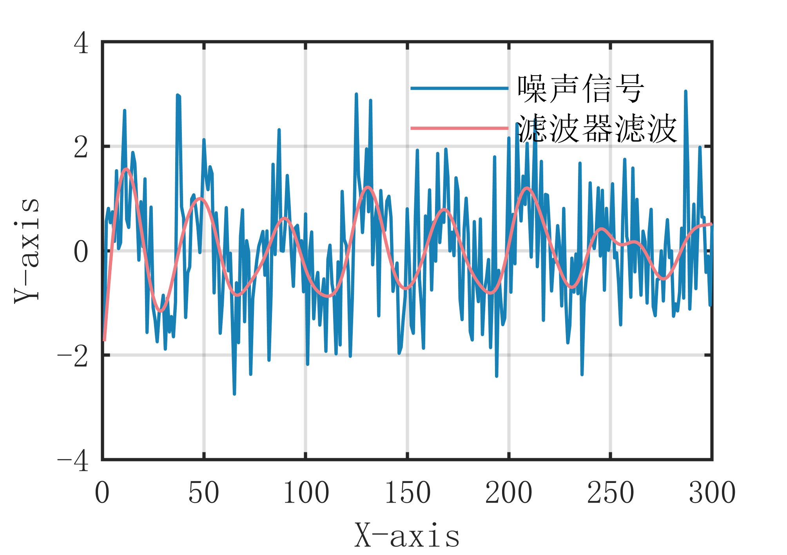

# MATLAB | Digital Signal Processing | Filter Algorithms | Included data and plotting code | Directly Useable

1. Basic Definition of Filtering Algorithm
A filtering algorithm based on digital filters is a method for eliminating noise through signal processing with filters. Digital filters can be categorized into FIR (Finite Impulse Response) and IIR (Infinite Impulse Response) types. FIR filters are linear phase filters, while IIR filters are nonlinear phase filters. Both types of filters can be used to process signals to eliminate noise. The steps of the filtering algorithm are as follows:
- Define a digital filter, including the type of filter, filter parameters, etc.
- Process the signal using the filter to obtain the filtered signal.
- Post-process the filtered signal, including signal amplification, translation, etc., to obtain the final filtering result. The advantage of the filtering algorithm is that it allows selecting different types of digital filters according to the characteristics of the signal to achieve optimal filtering effects; however, it requires designing and adjusting the filter parameters, which has higher complexity, and the stability and phase response of the filter need to be considered.
2. Definition and Outline Effects
The outlining effect is as follows:
\n        \n  
Video tutorial operation:
\n        \n          \n          \n          \n          \n            To view this video please enable JavaScript, and consider upgrading to a\n            web browser that\n            supports HTML5 video

## Images

<!-- PAYMENT_BLOCK -->

## Get this dataset

- Payment link (Stripe): [Buy now](https://buy.stripe.com/3cs8yP7sY87d0vu9AB)
- Payment QR code: 

<!-- /PAYMENT_BLOCK -->
